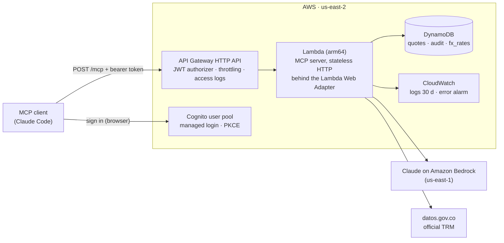
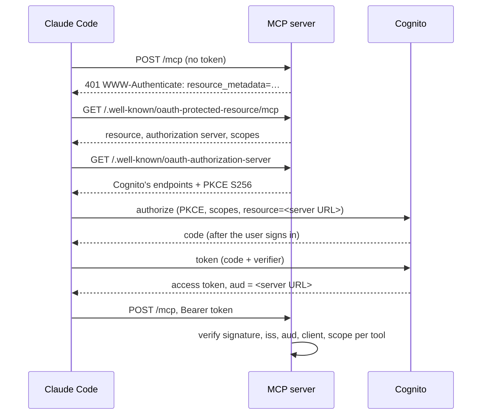

# cotizador-mcp

An MCP server that gives AI agents governed access to a real pricing engine.

The engine comes from a web app a personal shopper uses to price US retail products
for resale in Colombia. It has produced more than 1,000 real quotes. This repository
exposes that engine to agents. What it tries to get right is the governance around
the tools: typed schemas, read-only annotations, errors the model can act on,
scoped OAuth, an audit record per call, and idempotent writes. All of it runs on
AWS serverless, deployed with CDK.

> **Status: built and tested; not yet deployed.** All four tools run locally over stdio
> and stateless HTTP, and Claude Code signs in to the HTTP server through Cognito. The
> AWS stack synthesizes, and CI runs on every push and pull request.
> Two things wait on the AWS account: Bedrock access for `extract_product`, and the
> first deploy. [Open items](#open-items) lists what is still unproven.

## Status

| | Deliverable | State |
| --- | --- | --- |
| M1 | Scaffold: Python 3.12, uv, `mcp` SDK, pytest, ruff | **Done** |
| M2 | Pricing engine ported from TypeScript, with parity tests | **Done** |
| M3 | Official COP/USD rate (TRM), cached daily, last-known fallback | **Done** |
| M4 | Tools: `quote_product` · `get_exchange_rate` · `extract_product` · `save_quote` | **Done** (`extract_product` not yet run live) |
| M5 | Local run over stdio and stateless Streamable HTTP | **Done** (screenshot to quote waits on `extract_product`) |
| M6 | AWS stack in CDK: Lambda, HTTP API, DynamoDB, least-privilege IAM, alarm | Synthesized, not deployed |
| M7 | OAuth 2.1 with Cognito; scope per tool | **Done**; Claude Code signs in end to end (local) |
| M8 | Audit trail: one DynamoDB record per tool call | **Done** |
| M9 | CI/CD with GitHub Actions and OIDC deploy roles | CI green; the deploy job waits on the first deploy |
| M10 | This README | **Done** |

## Architecture



The server is stateless by protocol (MCP revision 2026-07-28 has no sessions), so any
Lambda instance can answer any request and nothing is kept between invocations.

## Tools

| Tool | Scope | Kind | What it does |
| --- | --- | --- | --- |
| `quote_product` | `quotes:read` | read-only, deterministic | US price + category or weight → published COP price with the full breakdown and an optional domestic-shipping estimate |
| `get_exchange_rate` | `quotes:read` | read-only | Today's official COP/USD rate, with its validity date, and whether it is live or the last one known |
| `extract_product` | `quotes:read` | read-only, calls a model | Name, current price, brand and category from a screenshot (Claude on Bedrock, schema-enforced output) |
| `save_quote` | `quotes:write` | write, idempotent | Recomputes the quote server-side and stores it once per caller and idempotency key |

### `quote_product`

| Input | Required | Notes |
| --- | --- | --- |
| `price_usd` | yes | Must be greater than 0 |
| `category` | no | One of `tenis`, `ropa`, `perfume`, `bolso`, `maquillaje`, `reloj`, `suplementos`. Supplies a typical weight |
| `weight_lb` | no | Wins over the category's weight when both are given |
| `zone` | no | `Bogotá`, `Ciudades principales`, `Resto del país`, `Municipio`. Adds a domestic-shipping estimate |

1. Add US sales tax and freight (per-pound tariff × weight) to get the landed cost in USD.
2. Convert at the official rate plus a buffer.
3. Add the margin.
4. Round up to the next 5,000 COP.

The commission is a share of the margin, so it never changes the price. The
domestic-shipping estimate is returned separately and is never part of `price_cop`.

Example: 120 USD sneakers, delivered in Bogotá, with the reference rate (real output
from MCP Inspector, abridged):

```json
{
  "price_cop": 735000,
  "landed_usd": 144,
  "fx_applied": 4080,
  "margin_cop": 146880,
  "commission_cop": 14688,
  "domestic_shipping_cop": 16000,
  "fx_source": "reference",
  "settings_source": "reference"
}
```

`fx_source` says which rate a quote used: `live` (today's official rate),
`last_known` (the source was down; `fx_valid_from` says how old it is) or `reference`
(a fixed stand-in, not a real rate). `settings_source` is always `reference`: margins,
tariffs, tax and commission are public reference values, not the business's real
configuration.

## Auth



- **Cognito is the authorization server; this server is the resource server.** It
  verifies each token against the pool's keys: issuer, `aud`, access-token use,
  registered client, expiry.
- **Tokens are bound to this server.** Clients send the RFC 8707 `resource`
  parameter and Cognito writes it into `aud`, so a token minted for another API in
  the same pool is refused.
- **Scopes per tool.** Every call needs `quotes:read`; `save_quote` also needs
  `quotes:write`. A token without it gets a tool error that names the missing scope,
  and the refusal is audited as `denied`.
- **Pre-registered clients.** Cognito has no dynamic client registration, which is
  the right posture anyway for a server with a write tool. Claude Code connects with
  a client id; it is a public client (PKCE, no secret).
- **A metadata shim.** Cognito's published metadata omits
  `code_challenge_methods_supported`, without which MCP clients must refuse to
  connect. The server publishes that document itself, pointing at Cognito's own
  endpoints. No token passes through it. Decision R1 has the details.

## Audit trail

Server middleware writes one record per `tools/call`, so a new tool is audited from
the moment it is registered. Each record holds:

- the OAuth `client_id`, `sub` and scopes;
- the tool, the argument *names*, and a SHA-256 of the arguments (never their values,
  so no images and no product data);
- the outcome: `ok`, `error`, `denied`, `replayed` or `crash`;
- latency, and model tokens for `extract_product`.

Records expire after 90 days (DynamoDB TTL). Each one is also logged as a JSON line,
so a failed table write still leaves a trail.

Every `save_quote` call by one client today:

```bash
aws dynamodb query --table-name "$AUDIT_TABLE" --key-condition-expression "client_id = :c AND begins_with(sk, :d)" --filter-expression "tool = :t" --expression-attribute-values '{":c":{"S":"<client-id>"},":d":{"S":"2026-11-08"},":t":{"S":"save_quote"}}'
```

Every call of one tool across clients uses the `by_tool` index instead.

## Threat model

| Threat | Mitigation |
| --- | --- |
| Stolen or replayed token | 60-minute access tokens bound to this server (`aud`); refresh tokens revocable; every call audited with `sub` and `client_id` |
| Token minted for another API | Audience must equal this server's URL, checked by API Gateway and again by the server |
| Scope escalation | Endpoint requires `quotes:read`; `save_quote` checks `quotes:write` itself; scopes advertised are exactly those clients may request |
| Rogue client registration | No dynamic registration; operators create app clients; self sign-up is off |
| Prompt injection through a screenshot | The system prompt marks image text as data; output is schema-constrained and re-validated (known category, positive price, length caps, control characters stripped); string fields are described to the calling agent as untrusted |
| Agent saves a made-up price | `save_quote` takes product inputs, never a price, and recomputes on the server |
| Duplicate writes on retry | Idempotency key per caller; same key returns the original save; reuse with different inputs is refused |
| SSRF through image URLs | URLs are not accepted; images are base64, at most 5 MB, and must match their declared type's magic bytes |
| Leaking internals in errors | Unexpected exceptions reach the model as a generic error; details stay in the logs |
| Cost abuse | Stage throttling (5 rps, burst 10); USD 5 budget with alerts from USD 1 |
| Unreviewed code deployed from CI | The deploy role trusts only GitHub's `production` environment, which admits only `main` and waits for the owner's approval; no AWS keys are stored in GitHub |
| DNS rebinding against a local server | Host header checked: loopback only locally, the public host only in AWS |

## Cost

At demo volume, a few hundred calls a month:

| Item | Monthly |
| --- | --- |
| Lambda (arm64, 1 GB, ~0.3 s a call) | < USD 0.01 |
| API Gateway HTTP API | < USD 0.01 |
| DynamoDB on demand, point-in-time recovery on quotes | < USD 0.05 |
| Cognito Essentials (first 10,000 monthly users free) | USD 0 |
| CloudWatch Logs, one alarm | ~ USD 0.10 |
| Claude on Bedrock: one model call per screenshot, about 1,500 tokens in and 300 out | about 1–2 cents per screenshot |

An account-level AWS Budget of USD 5 alerts at USD 1, 4.25 and 5, and on a forecast
over 5 (decision R7).

## Run it locally

You need [uv](https://docs.astral.sh/uv/). It installs the right Python by itself.

```bash
uv sync
```

```bash
uv run pytest
```

**stdio**, which is how a local client launches it:

```bash
uv run cotizador-mcp
```

**Stateless HTTP without auth** (refused on anything but 127.0.0.1):

```bash
uv run cotizador-mcp --transport http --port 8000
```

**Stateless HTTP with Cognito**: copy `.env.example` to `.env.dev`, fill in a user
pool, then:

```bash
set -a && source .env.dev && set +a && uv run cotizador-mcp --transport http --port 8000
```

**MCP Inspector** lists and calls the tools without an AI client:

```bash
npx -y @modelcontextprotocol/inspector@2.14.0 --cli uv run cotizador-mcp --method tools/list
```

```bash
npx -y @modelcontextprotocol/inspector@2.14.0 --cli uv run cotizador-mcp --method tools/call --tool-name quote_product --tool-arg price_usd=120 --tool-arg category=tenis
```

`extract_product` calls Claude on Bedrock with your AWS credentials (`aws login`
works). Without Bedrock access it says so and asks the agent to collect the details
from the user.

## Connect from Claude Code

Over stdio, from the repository root:

```bash
claude mcp add cotizador -- uv run --directory "$PWD" cotizador-mcp
```

Over HTTP with OAuth (local server or the deployed URL), using the Cognito app
client id. Claude Code opens the browser for the sign-in:

```bash
claude mcp add --transport http --client-id <app-client-id> --callback-port 8765 cotizador <server-url>/mcp
```

## Deploy

Deploying creates billable resources; at demo volume they cost cents a month.

1. Bootstrap CDK in the account and region (once):
   ```bash
   npx -y aws-cdk@2.1148.0 bootstrap aws://<account>/us-east-2
   ```
2. Deploy the CI roles (once):
   ```bash
   npx -y aws-cdk@2.1148.0 deploy CotizadorMcpCi
   ```
   Then, in GitHub, create the `production` environment (deployment branch `main`,
   required reviewer: you) and set, from the stack's outputs:
   - environment secrets `AWS_DEPLOY_ROLE_ARN` and `ALARM_EMAIL`;
   - repository secret `AWS_DIFF_ROLE_ARN`;
   - repository variables `AWS_DEPLOY_ENABLED=true` and `AWS_DIFF_ENABLED=true`.

   They are secrets, not variables, because the logs of a public repository are public
   and GitHub masks secrets in them.
3. From then on, a merge to `main` deploys `CotizadorMcp` once you approve it. To deploy
   by hand:
   ```bash
   npx -y aws-cdk@2.1148.0 deploy CotizadorMcp -c alarm_email=<you@example.com>
   ```
4. Create a user (Cognito emails a temporary password), then connect Claude Code with
   the `McpUrl` and `ClaudeCodeClientId` outputs:
   ```bash
   aws cognito-idp admin-create-user --user-pool-id <UserPoolId> --username <email> --user-attributes Name=email,Value=<email> Name=email_verified,Value=true
   ```

## Design notes

- **Stateless by protocol.** MCP revision 2026-07-28 removed sessions; every request
  carries its own protocol version and client capabilities. A `tools/call` works cold.
- **Errors the model can act on.** Expected failures raise the SDK's `ToolError`, and
  the model sees the reason and a way forward. Anything unexpected reaches the model
  only as a generic error.
- **Parity with the original.** `tests/fixtures/parity.json` holds outputs produced by
  *running* the TypeScript engine at a pinned commit; the Python port matches every
  one, including JavaScript's rounding of halves.
- **Same code locally and in AWS.** The Lambda runs the same Starlette app under
  uvicorn; only the stores change (memory locally, DynamoDB in AWS).
- **No real configuration.** The business's real settings are not in this repository.

Every decision, with its reasons and the gotchas found along the way, is in
[`docs/decisions.md`](docs/decisions.md).

## Open items

- **`extract_product` live.** The request reaches Bedrock correctly signed; the new
  AWS account is still blocked from calling Claude models (a support case is open).
- **First deploy.** API Gateway's 401 cannot carry the `resource_metadata` challenge,
  so clients must find the metadata at its well-known URLs (public routes here). To
  be checked against the deployed URL (decision R8).

## License

[MIT](LICENSE)
